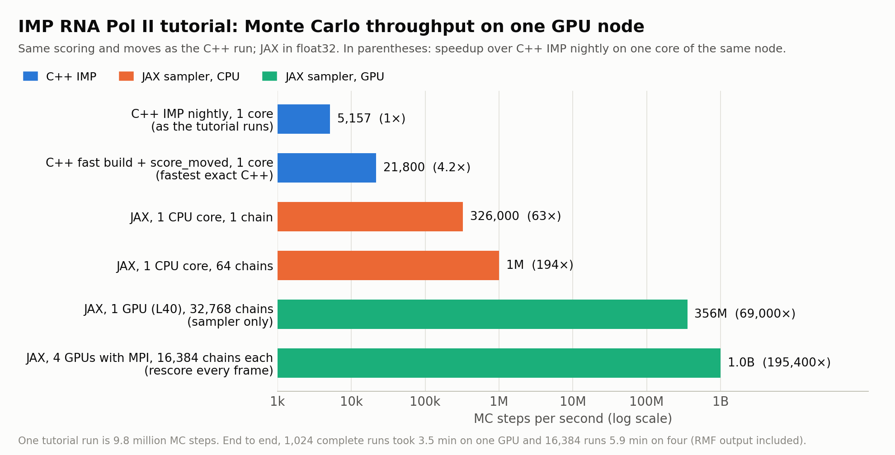

# Prototype: an exact, batched JAX Monte Carlo sampler for the RNA Pol II tutorial

**Status: a crude prototype for discussion, not proposed for merging.** It
runs the sampling of the IMP tutorial
([salilab/imp_tutorial](https://github.com/salilab/imp_tutorial),
`rnapolii/modeling/modeling.py`) for many independent chains on a GPU. It is
written for this one system; the parts that could be generalized into IMP
are listed under [Toward IMP](#toward-imp).

**Update (2026-10-21):** a second sampler, `sampler_soa.py`, run by
`run_soa.py`, with the same moves and energies. It is 1.8–2.1 times as fast
per GPU at 16,384–32,768 chains; see
[Faster sampler](#faster-sampler-run_soapy).

**"Exact" here means:**
* the same scoring function and the same moves as the C++ run;
* every term agrees with C++ to float64 round-off (see
  [Validation](#exactness-and-validation)).

There are three known differences:
* model Gaussian covariances follow the rigid bodies, while C++ uses a stale
  cache (salilab/imp#1119). This is a deliberate choice, and `--cov frozen`
  reproduces C++;
* the EM restraint uses the pairs within its cutoff, while C++ uses
  history-dependent close-pair lists (salilab/imp#1121);
* sampling runs in float32 by default.



The figure shows the first version: `run_mpi.py` at commit ca01dbfce5.

## What it does

* **Builds the system with the tutorial's own `modeling.py`.**
  * The script is run in-process with `mc1.execute_macro()` removed and
    `--test` passed. That only shortens the tutorial's frame count, which
    is not used here.
  * Restraint parameters are read from the C++ objects. For the EM
    restraint, they are recorded from its constructor arguments, because
    there are no getters (`build_system.py`, `scoring.py`).
* **Runs the same Monte Carlo as PMI:**
  * the `SerialMover` over `dof.get_movers()` (47 `BallMover`s on flexible
    beads, 2 `RigidBodyMover`s on the stalk), one mover per MC step in the
    same order;
  * Metropolis acceptance;
  * PMI's simulated-annealing schedule;
  * 490 MC steps per frame.
* **Many chains at once:** each chain is an independent copy of the
  tutorial's run, and chains are batched with `jax.vmap`. All chains start
  from the tutorial's shuffled model (`build(seed=1)`) and differ in their
  random numbers. `initial_state()` also accepts per-chain starts.
* **Incremental energies.** A step scores only the terms that involve the
  moved particles (`sampler.py`):
  * a bead step: its excluded volume against every other particle, its
    bonds and its cross-links;
  * a rigid-body step: the body's excluded volume, its cross-links and the
    EM restraint.

  A full rescore every frame removes float32 drift.
* **Output:** one RMF file per chain, written by background processes while
  the GPU keeps sampling; per-frame scores and terms; the 10 best-scoring
  models (`run_chains.py`).
* **Several GPUs through `IMP.mpi`**, one rank per GPU (`run_mpi.py`):
  * independent runs;
  * or PMI-style replica exchange, where neighbouring ranks swap chain
    configurations with IMP.mpi's acceptance rule.

## Speed

All speeds are MC steps per second, as IMP counts them (one mover proposal
plus one Metropolis test). One complete tutorial run is 20,000 frames ×
490 = 9.8 million MC steps.

All on one GPU node with four L40s. Software: IMP nightly 20261014, JAX
0.11.2 (CUDA 12). The 356M row is from this commit with nightly 20261019.
All JAX speeds are float32.

| | MC steps/s |
|---|---|
| C++ IMP nightly, one core, as the tutorial runs (`score_moved` off) | 5,157 |
| C++ `imp-fast` nightly, `score_moved=True`, one core (the fastest exact C++) | 21,800 |
| JAX, one CPU core, one chain | 326,000 |
| JAX, one CPU core, 64 chains | 1.0 million |
| JAX, one L40, 32,768 chains, sampler only (`bench_chains.py`) | 356 million |
| JAX, `run_mpi.py` with a rescore every frame, 16,384 chains per GPU: one L40 | 249 million |
| same, four L40s on one node | 1.0 billion |

* **For scale** (an estimate, not measured): a whole 64-core node running
  the fastest C++ would do about 64 × 21,800 ≈ 1.4 million MC steps/s. One
  L40 is about 250 times that.
* **End to end:**
  * 1,024 complete tutorial runs take 3.5 min on one L40, with an RMF frame
    every 200 frames;
  * 16,384 runs take 5.9 min on four L40s, with an RMF frame every 2,000
    frames.

  The C++ tutorial writes RMF, stat files and best-model PDBs every frame.
* **Per chain**, a GPU runs about 40–60k MC steps/s up to ~1,000 chains,
  limited by kernel-launch latency. The throughput comes from running many
  chains at once.

## Faster sampler (`run_soa.py`)

`run_soa.py` runs the same protocol as `run_mpi.py --mode independent`, with
the same moves and energies. "First version" below means the code at
commit ca01dbfce5. All the changes are exact:

* **A grid for the static excluded volume.** The 369 static EV rows (from
  particles that never move) are binned once on a 6 Å grid. A moving row is
  scored only against the static rows within reach of its cell: at most 21
  instead of 369 (`TutSampler._build_grid`).
* **Rigid-body steps without copying the coordinates.** The moved body's own
  rows are masked, and the cross-links and EM read its new block directly.
* These first two changes are in `sampler.py`. They are on by default on a
  GPU, so `run_chains.py`, `run_mpi.py` and `bench_chains.py` in this
  commit use them too (`TutSampler(grid=False)` turns the grid off).
* **Struct-of-arrays layout** (`sampler_soa.py`).
  * The chain index is the last, fastest-varying axis of every state array,
    so the many small per-step loads and stores of consecutive chains
    coalesce.
  * One random key serves all chains.
  * Rotations are elementwise float32 products, never `dot_general`, which
    can run as TF32 on the GPU (salilab/imp#1129).
* **Blocks of frames in one device call** (a `lax.scan` over 20 frames by
  default). A block covers the 10 sweeps per frame, the full rescore, the
  drift statistics, the scores and each frame's 10 best configurations. The
  next block is dispatched before the previous block's records are read, so
  the host's work overlaps with sampling.
* **Output as snapshots of the sampled degrees of freedom**: rigid-body
  quaternions and translations, and bead positions, 620 bytes per chain per
  snapshot. They are written by a background thread. `dofs_to_rmf.py` makes
  RMF files afterwards, for the N best configurations or per chain, in
  parallel.

**Speed**, MC steps/s, of the production loop with a full rescore every
frame. Both columns were measured on the same day, on one GPU node with four
L40s (IMP nightly 20261020, JAX 0.11.2, float32):

| | first version (`run_mpi.py`) | `run_soa.py` |
|---|---|---|
| one L40, 16,384 chains | 245 million | 512 million |
| one L40, 32,768 chains | 335 million | 668 million |
| four L40s, 16,384 chains per GPU | 1.12 billion | 2.05 billion |
| four L40s, 32,768 chains per GPU | not measured | 2.64 billion |

* In its four-GPU run, the first version ran at about 280 million per GPU,
  faster than in its one-GPU run (245 million). We did not find out why.
  So, per GPU, `run_soa.py` is 1.8–2.1 times as fast.
* The first version's numbers in [Speed](#speed) above (249 million on one
  L40, 1.0 billion on four) were measured earlier.
* `run_soa.py` scales 4.0 times from one GPU to four.
* Small runs gain less (1.1–1.3 times at 4,096 chains or fewer per GPU):
  each sweep is then limited by its ~340 kernel launches.

**End to end**: complete tutorial runs of 20,000 frames. The first version's
times are its earlier measurements (see [Speed](#speed)).

| | first version | `run_soa.py`, then `dofs_to_rmf.py` |
|---|---|---|
| 1,024 runs, one L40, RMF of every chain every 200 frames | 3.5 min | 3.1 min |
| 16,384 runs, four L40s, RMF of every chain every 2,000 frames | 5.9 min | 4.7 min |
| 131,072 runs, four L40s, snapshots every 200 frames, scores every 10 | not measured | 8.8 min, plus 8 s for RMF of the 1,000 best configurations |

* The `run_soa.py` times include `dofs_to_rmf.py --per-chain` for all
  chains: 12 s for the first row (32 processes) and 31 s for the second.
* In the last run, sampling with output ran at 2.58 billion MC steps/s.

### Choosing how EV against the rigid bodies is scored (`ev_select.py`)

There are two exact schemes for the EV between the rigid bodies' rows and
the other moving rows, in both bead and rigid-body steps:
* **dense:** all pairs of a body's EV rows with the other dynamic EV rows;
* **per-body grids:** each body's EV rows in a grid fixed in the body's own
  frame. Queries are transformed into that frame, so rotations never
  invalidate the grid. It needs no rebuilds and no neighbour-list skin.

Which one is faster depends on the body sizes and the number of chains.
`run_soa.py --ev auto` (the default) picks one per run:
* if the largest body has fewer than 30 EV rows: dense, without a trial;
* otherwise, a timed trial. Both production blocks are compiled and timed on
  copies of the starting state, at the run's chain count. The grids must be
  at least 2% faster to be picked.
  * With several ranks under Open MPI, each rank times both, and the ranks
    agree on the summed times through files in `OUT/ev_select/`.
  * The decision is remembered in `--tune-cache`. It is keyed by the
    system, the chain count, the block length, the GPU model, the JAX
    version and the sampler code.

`--ev dense` and `--ev body` force a scheme.

The tutorial's bodies have 18–19 EV rows each, so the tutorial runs dense;
the grids are up to about 25% slower on it. To test larger bodies,
`run_soa.py --ev-res 1` (or `TUT_EV_RES=1` for the other scripts) builds
the tutorial with its `ExcludedVolumeSphere` at resolution 1 instead of 10.
That gives bodies of 177 and 171 EV rows. One L40, MC steps/s of the
production loop with a full rescore every frame:

| EV resolution 1 | 4,096 chains | 16,384 chains | 32,768 chains |
|---|---|---|---|
| dense | 54.6 million | 58.6 million | 19.0 million |
| per-body grids | 71.5 million | 81.3 million | 59.8 million |

* Dense drops at 32,768 chains because the dynamic rows' coordinates no
  longer fit in the L2 cache.
* The trial picked the grids at 16,384 and 32,768 chains.
* At 1,024 chains the two are within 2% of each other, and the trial has
  picked either.

### Checks of `run_soa.py`

* **Per-move energy changes** (`verify.py`): 512 equilibrated states,
  against the first version in float64.
  * float64: 1e-14 for beads, 4e-13 for rigid bodies.
  * float32: the rigid-body error is at most about 3e-4 kT, against 2.1 kT
    for the first version (TF32, salilab/imp#1129). No accept/reject
    decision flips; 0.1% flipped before.
* **At EV resolution 1:**
  * EV agrees with C++ to 6.8e-13 (`validate_terms.py`);
  * per-move changes in float64 agree to 3.8e-13 (dense) and 5.4e-13
    (per-body grids).
* **Ensemble:** the first version against `run_soa.py`, 8,192 chains each,
  200 frames at kT 1 from the shuffled start (the start of the annealing
  schedule). We compared the chain means of each term in frames 1–10,
  10–50, 50–100 and 100–200 with a short script on the two runs'
  `scores.npy`; the script is not included. Every term agrees within
  |z| < 1.8 in every window, and within 0.92 in frames 100–200.
* **RMF made from snapshots and rescored by C++** (`check_rmf.py`): within
  4.3e-4 of the recorded scores at both EV resolutions, once the EM list
  effect (salilab/imp#1121) is accounted for.

## Exactness and validation

* **Terms** (`validate_terms.py`, float64, at the shuffled start and at
  configurations along a C++ MC trajectory; IMP nightly 20261019):

  | term | max abs difference from C++ |
  |---|---|
  | connectivity | 6e-11 |
  | excluded volume | 5e-13 |
  | EM, with C++'s own close-pair lists | 1e-13 |
  | cross-links | 1.2e-6 (0 for the numpy reference that emulates C++'s `float` arithmetic in `sphere_cap`) |

  With `--cov rotate`, EM is compared with C++ after
  `update_global_covariance()` on the model Gaussians, which is what
  salilab/imp#1118 would do.
* **Sampler** (`check_sampler.py`, nightly 20261019): the incrementally
  tracked energy equals a full recompute to 1e-9 in float64 (energies
  ~3e5).
* **Output** (`check_rmf.py`): RMF frames from a run, loaded into IMP and
  rescored by C++, match the recorded scores once the EM list effect above
  is accounted for:
  * to 2e-2 (2.5e-5 relative) for a float32 GPU run (nightly 20261019);
  * to 3e-4 for a float32 CPU run (2026-10-13).
* **Final results** (`compare_final.py`, nightly 20261019): complete runs
  of the tutorial's protocol (20,000 frames with annealing) from the
  tutorial's shuffled start.
  * 60 C++ runs: the fast build with `score_moved`, which is exact and only
    faster.
  * 1,024 JAX chains, with `--cov frozen` as in C++.

  | | C++ (60 runs) | JAX, EM pairs within cutoff + 2 Å | JAX, EM pairs within cutoff |
  |---|---|---|---|
  | final score | 611.5 ± 2.3 | 611.3 ± 0.5 | 610.1 ± 0.5 |
  | best score per run | 594.5 ± 2.0 | 594.6 ± 0.4 | 593.6 ± 0.5 |
  | EM, second half at kT 1 | 129.6 ± 0.5 | 130.0 ± 0.1 | 128.0 ± 0.1 |
  | total, second half at kT 1 | 615.4 ± 2.1 | 614.8 ± 0.5 | 613.6 ± 0.5 |
  | final Rpb4 / Rpb7 position, distance from the C++ mean | | 1.2 / 1.0 Å | 1.7 / 1.8 Å |

  * **EM pairs within the cutoff + 2 Å** (what a freshly rebuilt C++ list
    holds): all 15 compared quantities agree with C++, with
    Kolmogorov–Smirnov and Mann–Whitney p ≥ 0.23. They are the final and
    best scores, every term, and the final position and orientation of both
    stalk subunits.
  * **EM pairs within the cutoff only** (the default here): EM is 1.6 units
    lower and the total about 1.8 lower, the effect of salilab/imp#1121. The
    stalk placement still agrees (p ≥ 0.1).
* **Distribution** (`ensemble.py`; 2026-10-13, C++ from conda IMP 2.25, an
  earlier version of this code, `--cov frozen`): 128 C++ runs against 256
  JAX chains, from the same shuffled start, 100 frames at kT 1.
  * Over frames 51–100, connectivity, excluded volume, cross-links and the
    total agree within about 1.2 standard errors.
  * EM differs by about one unit, because of the C++ EM lists
    (salilab/imp#1121).
  * At the checkpoints at frames 1–50 the total agrees within 1.5 SE, with
    cross-links 2–3.5 SE high at frames 2–5 only.
  * Per-mover acceptance agrees.
* **Replica exchange** (`run_mpi.py --mode rex`):
  * received configurations rescore to within 2 float32 ulps of what the
    sender sent;
  * neighbour acceptance is 0.20–0.21 on kT 1–2.5.

  It has **not** been compared with C++ PMI replica exchange.

## Files

| file | contents |
|---|---|
| `build_system.py` | builds the tutorial's system in-process, stopping before sampling |
| `scoring.py` | `TutSystem` (static tables read from the C++ objects) and the scoring terms, for numpy or jax.numpy |
| `sampler.py` | `TutSampler`: the batched, incremental MC step (optionally with the static EV grid) |
| `sampler_soa.py` | `TutSamplerSoA`: the struct-of-arrays sampler, with optional per-body EV grids |
| `run_chains.py` | N independent tutorial runs on one device, with RMF output |
| `run_mpi.py` | several GPUs, one MPI rank each, through `IMP.mpi` (independent runs or replica exchange) |
| `run_soa.py` | the tutorial's runs on one or several GPUs with `TutSamplerSoA`; DOF snapshots as output |
| `ev_select.py` | picks dense or per-body-grid EV for a run (heuristic, timed trial, cache) |
| `dofs_to_rmf.py` | RMF files from `run_soa.py` snapshots: the N best configurations, or per chain |
| `fast_dofs.py` | sets the tutorial model's coordinates from DOFs (the beads in one numpy assignment), for the RMF writers |
| `verify.py` | per-move energy changes of sampler variants against a float64 reference |
| `validate_terms.py` | per-term comparison with C++ in float64 |
| `check_sampler.py` | incremental energy against a full recompute, plus a speed probe |
| `check_rmf.py` | rescores a run's RMF frames with C++ |
| `ensemble.py` | C++ against JAX score distributions |
| `compare_final.py` | final results of complete C++ and JAX runs |
| `bench_chains.py` | throughput against the number of chains |

## Running

You need an IMP nightly (with `IMP.mpi` for `run_mpi.py`), JAX 0.11.2 (with
CUDA for a GPU) and numpy. Set `IMP_TUTORIAL` to a clone of
`salilab/imp_tutorial` (tested at commit 8058229).

```bash
export IMP_TUTORIAL=/path/to/imp_tutorial
JAX_PLATFORMS=cpu python validate_terms.py --configs 4
JAX_PLATFORMS=cpu python check_sampler.py --x64
python bench_chains.py --chains 1024 4096 16384
python run_chains.py --chains 1024 --frames 20000 --thin 200 --writers 8 --out runs/x
python check_rmf.py runs/x
mpirun -np 4 python run_mpi.py --mode independent --chains 4096 --frames 20000 --thin 2000 --out runs/mpi
mpirun -np 4 python run_mpi.py --mode rex --chains 1024 --frames 2000 --out runs/rex
# the faster sampler (run_soa.py does not need IMP.mpi; mpirun only starts the ranks)
python run_soa.py --chains 1024 --frames 20000 --thin 200 --out runs/soa
python dofs_to_rmf.py runs/soa --per-chain --chains 0 1 2
python check_rmf.py runs/soa/rank0
mpirun -np 4 python run_soa.py --chains 32768 --frames 20000 --thin 200 --score-every 10 --out runs/soa4
python dofs_to_rmf.py runs/soa4 --best 1000 --procs 8
python verify.py --out ref.npz --x64 --grid 0
python verify.py --out f32.npz --soa
python verify.py --compare ref.npz f32.npz
```

## Relation to IMP's JAX path

This sampler does not use IMP's JAX `MonteCarlo` or the restraints'
`_get_jax()`. It reads parameters from the C++ objects and has its own
scoring code.

IMP develop (4c5f9ef0cf) cannot yet run this tutorial through its JAX path.
`isd.GaussianEMRestraint` has no `_get_jax`, and the PMI excluded-volume
restraint (`PairsRestraint` over a `ClosePairContainer` with
`RigidClosePairsFinder`) would also need its rigid-body exclusion in JAX.

## Limitations

* **Specific to this system.**
  * Supported restraints:
    * connectivity: `SphereDistancePairScore(HarmonicUpperBound)` pairs;
    * PMI excluded volume: a soft sphere over a close-pair container with
      rigid-body exclusion, scored densely or through grids;
    * single-contribution `CrossLinkMSRestraint`s with fixed σ and ψ;
    * `isd.GaussianEMRestraint`.
  * Supported movers: `BallMover`s on nonrigid members of fixed bodies, and
    `RigidBodyMover`s.
  * Other restraint names, mover types or restraint variants raise
    `NotImplementedError`.
* **EM close-pair lists and covariances:** see the differences at the top.
  `validate_terms.py` checks EM on C++'s own lists.
* **The cross-link forward model** is the one IMP currently computes
  (salilab/imp#1120). If salilab/imp#1123 is merged, `xl_neglogp()` in
  `scoring.py` needs the same change.
* **float32 by default**, on CPU and GPU, with a full rescore every frame.
  float64 works on both (`--dtype float64`).
* **TF32 in `sampler.py` on a GPU.** `TutSampler` (`run_chains.py`,
  `run_mpi.py`) rotates rigid bodies and EM covariances with matrix
  products, which can run as TF32 (salilab/imp#1129). In float32 that gives
  up to 2.1 kT error in a rigid-body move's energy change, and flips 0.1% of
  those moves' accept/reject decisions. The final-result comparison above
  ran this code on a GPU in float32 and still agrees with C++.
  `TutSamplerSoA` (`run_soa.py`) uses elementwise products and does not
  have this problem.
* **Output is not PMI's:** RMF per chain plus `scores.npy` (`run_chains.py`,
  `run_mpi.py`), or DOF snapshots converted to RMF on demand (`run_soa.py`),
  not stat files. There is no checkpoint/restart.
* **`run_soa.py` has no replica exchange yet**; `run_mpi.py --mode rex`
  has it.

## Toward IMP

These pieces are generic, not tied to this system:

1. **Many chains per process.** Batch the sampler state over chains. IMP's
   JAX attribute sets (multiple coordinate sets per model, in develop since
   October 2026) are the natural basis.
2. **Incremental (moved-particle) JAX scoring.** Each restraint provides the
   energy change for a move of one particle or rigid body, from per-mover
   index tables built once.
3. **A fused `SerialMover` step without branches.** Each step is specialized
   for its mover (static indices) and uses `where`-based Metropolis, so
   `vmap` over chains does not execute every branch.
4. **Compact, component-first state.** Only the particles the restraints
   use, with static particles shared between chains.
5. **A rank-per-GPU helper for `IMP.mpi`** replica exchange, swapping
   configurations; plus RMF writer processes spawned before `MPI_Init`.
6. **A struct-of-arrays state** with the chain index innermost, so that
   per-step memory accesses coalesce on the GPU (`sampler_soa.py`).
7. **Choosing an algorithm per system with a short timed trial**, cached,
   with a size threshold only to skip clear cases (`ev_select.py`).
8. **Sampled degrees of freedom as output**, with RMF made afterwards for
   the frames that are needed (`run_soa.py`, `dofs_to_rmf.py`).
